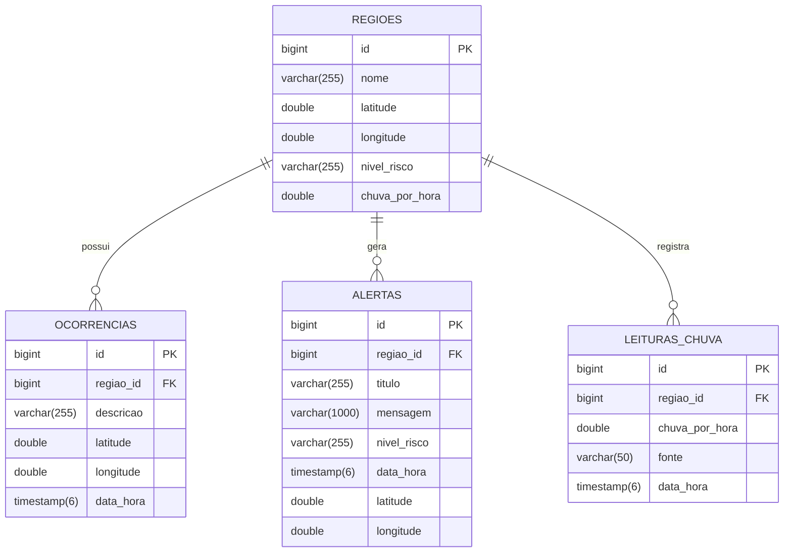

# FloodGuard Backend

Sistema de monitoramento e alerta de risco de alagamentos, desenvolvido em Spring Boot. O backend recebe dados de chuva e ocorrências relatadas, calcula automaticamente o nível de risco de cada região monitorada e gera alertas quando o risco se torna relevante.

## 📌 Sobre o projeto

O FloodGuard nasceu da necessidade de monitorar regiões urbanas suscetíveis a alagamentos, cruzando dois tipos de informação:

- **Volume de chuva** (mm/h) informado para uma região
- **Ocorrências reportadas** por moradores, em cada região, nas últimas horas

Com base nesses dois fatores, o sistema classifica automaticamente o risco em 4 níveis e dispara um alerta quando necessário — sem intervenção manual.

## 🏗️ Arquitetura

O projeto segue a arquitetura em camadas padrão do Spring Boot:

```
Controller  →  Service  →  Repository  →  Banco de Dados
```

- **Controller**: expõe os endpoints REST e trata requisições HTTP
- **Service**: contém as regras de negócio (cálculo de risco, criação de alertas)
- **Repository**: interfaces do Spring Data JPA para acesso ao banco
- **Model**: entidades JPA mapeadas para as tabelas do PostgreSQL
- **DTO**: objetos de transferência usados para validar dados de entrada e moldar respostas
- **Exception**: exceções customizadas com status HTTP apropriado

### Estrutura de pastas

```
floodguard-backend/
├── database/
│   └── init.sql                      # criação das tabelas (PostgreSQL)
├── docker-compose.yml                # sobe o PostgreSQL já com o init.sql
├── pom.xml
└── src/main/
    ├── java/com/floodguard/
    │   ├── controller/
    │   │   ├── AlertaController.java
    │   │   ├── LeituraChuvaController.java
    │   │   ├── OcorrenciaController.java
    │   │   └── RegiaoController.java
    │   ├── dto/
    │   │   ├── LeituraChuvaRequest.java
    │   │   ├── OcorrenciaRequest.java
    │   │   └── RiscoResponse.java
    │   ├── exception/
    │   │   └── RecursoNaoEncontradoException.java
    │   ├── model/
    │   │   ├── Alerta.java
    │   │   ├── LeituraChuva.java
    │   │   ├── NivelRisco.java
    │   │   ├── Ocorrencia.java
    │   │   └── Regiao.java
    │   ├── repository/
    │   │   ├── AlertaRepository.java
    │   │   ├── LeituraChuvaRepository.java
    │   │   ├── OcorrenciaRepository.java
    │   │   └── RegiaoRepository.java
    │   ├── service/
    │   │   ├── AlertaService.java
    │   │   ├── LeituraChuvaService.java
    │   │   ├── OcorrenciaService.java
    │   │   └── RiscoService.java
    │   └── FloodGuardApplication.java
    └── resources/
        └── application.properties
```

## 🧠 Regra de negócio: cálculo de risco

O `RiscoService` classifica o nível de risco cruzando `chuvaPorHora` (mm) com o número de ocorrências registradas **na própria região** nas **últimas 2 horas**. Ocorrências de outras regiões não entram na conta:

| Nível | Condição |
|---|---|
| `EMERGENCIA` | chuva ≥ 50mm/h **e** ≥ 3 ocorrências |
| `RISCO` | chuva ≥ 30mm/h **ou** ≥ 3 ocorrências |
| `ATENCAO` | chuva ≥ 15mm/h **ou** ≥ 1 ocorrência |
| `NORMAL` | nenhuma das condições acima |

Sempre que uma região deixa de estar em `NORMAL`, um **alerta é criado automaticamente**, vinculado à região e contendo título, mensagem, nível e as coordenadas dela.

## 🔌 Endpoints da API

### Regiões

| Método | Rota | Descrição |
|---|---|---|
| `GET` | `/api/regioes` | Lista todas as regiões cadastradas |
| `POST` | `/api/regioes` | Cadastra uma nova região |
| `PUT` | `/api/regioes/{id}/risco?chuvaPorHora=X` | Recalcula o risco da região e gera alerta se necessário |

**Exemplo — cadastrar região:**
```bash
curl -X POST http://localhost:8080/api/regioes \
  -H "Content-Type: application/json" \
  -d '{"nome":"Vila Prudente","latitude":-23.58,"longitude":-46.58}'
```

**Exemplo — atualizar risco:**
```bash
curl -X PUT "http://localhost:8080/api/regioes/1/risco?chuvaPorHora=40"
```

Retorna `404` se a região não existir.

### Ocorrências

| Método | Rota | Descrição |
|---|---|---|
| `GET` | `/api/ocorrencias` | Lista todas as ocorrências |
| `POST` | `/api/ocorrencias` | Registra uma nova ocorrência de alagamento em uma região |

Toda ocorrência pertence a uma região, então o campo `regiaoId` é **obrigatório**.

**Exemplo:**
```bash
curl -X POST http://localhost:8080/api/ocorrencias \
  -H "Content-Type: application/json" \
  -d '{"regiaoId":1,"descricao":"Alagamento na Rua X","latitude":-23.58,"longitude":-46.58}'
```

| Situação | Resposta |
|---|---|
| Campos obrigatórios ausentes ou descrição vazia | `400` |
| `regiaoId` de uma região que não existe | `404` |

### Leituras de chuva

Guarda o histórico de chuva de cada região (hoje a chuva da região é sobrescrita a cada atualização de risco).

| Método | Rota | Descrição |
|---|---|---|
| `POST` | `/api/leituras-chuva` | Registra uma leitura de chuva para uma região |
| `GET` | `/api/leituras-chuva/regiao/{regiaoId}` | Lista as leituras da região, da mais recente para a mais antiga |

**Exemplo:**
```bash
curl -X POST http://localhost:8080/api/leituras-chuva \
  -H "Content-Type: application/json" \
  -d '{"regiaoId":1,"chuvaPorHora":22.5,"fonte":"MANUAL"}'
```

`regiaoId` e `chuvaPorHora` são obrigatórios; `fonte` é opcional. Registrar uma leitura **apenas guarda o histórico**: o nível de risco só é recalculado por `PUT /api/regioes/{id}/risco`.

### Alertas

| Método | Rota | Descrição |
|---|---|---|
| `GET` | `/api/alertas` | Lista todos os alertas gerados automaticamente |

## 🗄️ Modelo de dados

O banco tem 4 tabelas. Regiões se relacionam com ocorrências, alertas e leituras de chuva por `regiao_id`:



- Todas as colunas são obrigatórias, exceto `leituras_chuva.fonte`.
- `nivel_risco` só aceita `NORMAL`, `ATENCAO`, `RISCO` ou `EMERGENCIA`.
- Não é possível registrar ocorrência, alerta ou leitura para uma região que não existe.
- A estrutura completa está em [`database/init.sql`](database/init.sql).

## ⚙️ Tecnologias

- Java 21
- Spring Boot 3.5.5
- Spring Data JPA / Hibernate
- PostgreSQL 16
- Docker e Docker Compose
- Bean Validation (`jakarta.validation`)
- Maven

## 🚀 Como rodar o projeto

### Pré-requisitos
- Java 21+
- Maven 
- Docker

### 1. Suba o banco de dados

Na raiz do projeto:

```bash
docker compose up -d
```

Isso baixa o PostgreSQL 16, cria o banco `floodguard` e executa o `database/init.sql`, que cria as tabelas. O banco fica disponível em **`localhost:5433`**. Usamos a 5433, e não a 5432 padrão, para não conflitar com um PostgreSQL que já esteja instalado na máquina.

Para conferir que as tabelas foram criadas:

```bash
docker exec -it floodguard-db psql -U postgres -d floodguard -c "\dt"
```

Devem aparecer `alertas`, `leituras_chuva`, `ocorrencias` e `regioes`.

Comandos úteis:

| O que fazer | Comando | Dados do banco |
|---|---|---|
| Pausar o banco | `docker compose stop` | Mantidos |
| Ligar de novo | `docker compose up -d` | Mantidos |
| Zerar tudo e recriar | `docker compose down -v` e depois `docker compose up -d` | **Apagados** |

> O `init.sql` só roda quando o banco é criado pela primeira vez. Se você alterar esse arquivo, use `docker compose down -v` para o banco ser recriado com a nova estrutura.

**Sem Docker (PostgreSQL instalado localmente):**
```bash
createdb floodguard
psql -d floodguard -f database/init.sql
```
Nesse caso, a porta padrão é a 5432: ajuste `spring.datasource.url` no `application.properties` de `5433` para `5432`.

### 2. Configure as credenciais (opcional)

Por padrão, tanto o `docker-compose.yml` quanto o `application.properties` usam `postgres/postgres`. **Esse padrão serve apenas para desenvolvimento local**; troque as credenciais em qualquer ambiente acessível pela internet. Para customizar, defina variáveis de ambiente **antes** de subir o banco:

```bash
# Linux / Mac
export DB_USER=seu_usuario
export DB_PASSWORD=sua_senha
```
```powershell
# Windows (PowerShell)
$env:DB_USER = "seu_usuario"
$env:DB_PASSWORD = "sua_senha"
```

A senha é definida na criação do banco. Se você mudar as credenciais depois, rode `docker compose down -v` e `docker compose up -d` para recriá-lo.

### 3. Rode a aplicação

```bash
mvn clean install
mvn spring-boot:run
```

Ou, pelo VS Code, abra `FloodGuardApplication.java` e clique em **Run**.

A API sobe em `http://localhost:8080`. As tabelas já foram criadas pelo `init.sql`; o Hibernate (`ddl-auto=update`) apenas complementa o que faltar.

### 4. Teste os endpoints

Use `curl`, Postman ou Insomnia para testar as rotas listadas acima. Fluxo sugerido:

1. Cadastre uma região (`POST /api/regioes`) e anote o `id` retornado
2. Registre uma ou mais ocorrências nessa região, informando o `regiaoId` (`POST /api/ocorrencias`)
3. *(Opcional)* Registre uma leitura de chuva (`POST /api/leituras-chuva`)
4. Atualize o risco da região informando a chuva (`PUT /api/regioes/{id}/risco?chuvaPorHora=X`)
5. Confira se um alerta foi gerado (`GET /api/alertas`)

> **Windows (PowerShell):** nele o `curl` é um apelido de outro comando e os exemplos acima não funcionam como estão. Use `Invoke-RestMethod`, por exemplo:
> ```powershell
> $corpo = @{ regiaoId = 1; descricao = "Alagamento na Rua X"; latitude = -23.58; longitude = -46.58 } | ConvertTo-Json
> Invoke-RestMethod -Method Post -Uri http://localhost:8080/api/ocorrencias -ContentType "application/json" -Body $corpo
> ```

### Problemas comuns

| Sintoma | Causa provável | O que fazer |
|---|---|---|
| `Connection to localhost:5433 refused` | O banco não está ligado | `docker compose up -d` (com o Docker aberto) |
| `password authentication failed` | A aplicação está falando com outro PostgreSQL, instalado na máquina, ou as credenciais não batem | Confira a porta no `application.properties` e as variáveis `DB_USER` e `DB_PASSWORD` |
| Erro 500 ao registrar ocorrência, mesmo com `regiaoId` | A aplicação está executando uma versão antiga já compilada | Pare a aplicação, apague a pasta `target` e rode de novo |

## 📋 Próximos passos

- [ ] Integração com API de clima externa para automatizar `chuvaPorHora`
- [ ] Notificações push (Firebase) para o alerta chegar em tempo real no mobile
- [ ] Autenticação e autorização
- [ ] Endpoints de detalhe (`GET /{id}`) e exclusão
- [ ] Testes automatizados (unitários e de integração)
- [ ] Documentação interativa da API (Swagger/OpenAPI)

## 👥 Equipe

Maria Eduarda de Faria Braz
Maiara Moraes de Sousa Silva
Mariana Reis Guimarães
Vinicius Henrique da Silva Santos